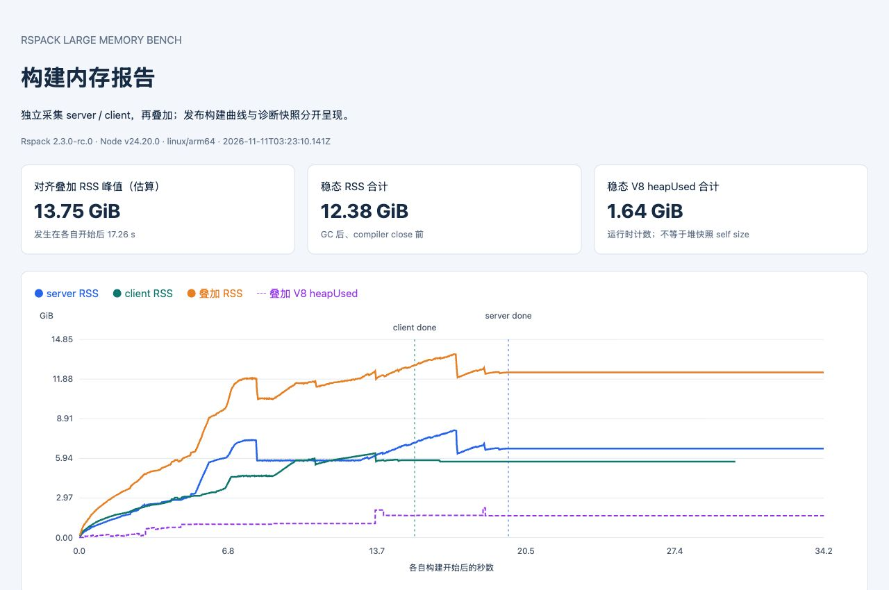
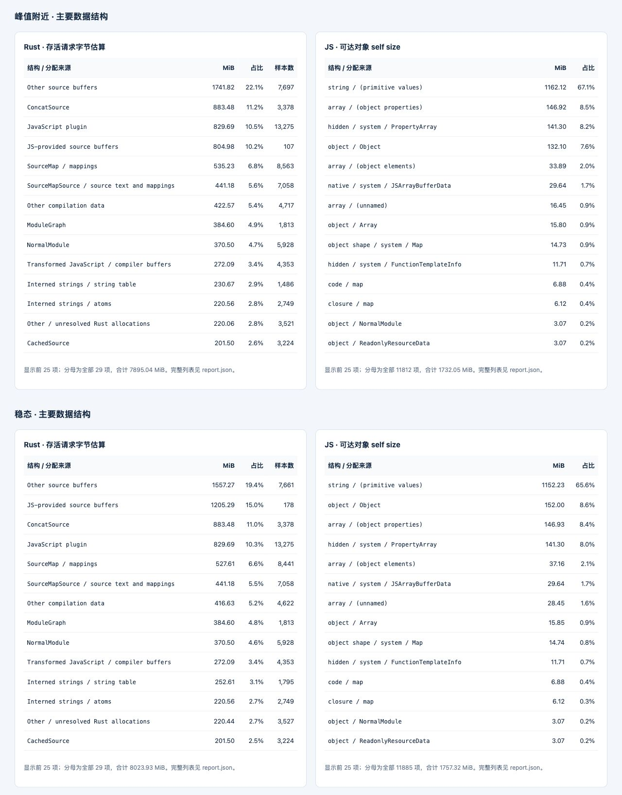
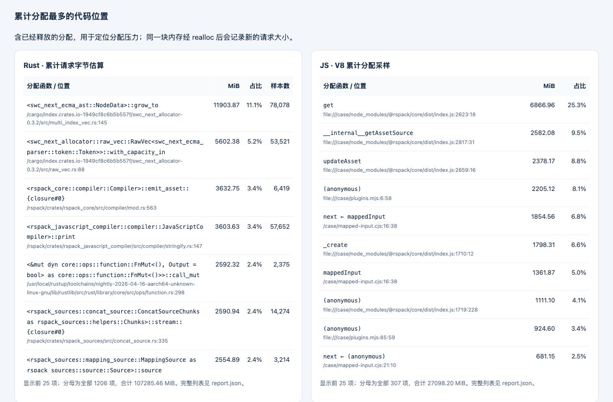

# Large dual-compiler memory benchmark

A deterministic synthetic workload for measuring Rspack peak RSS and retained memory. It needs only Node, npm, and a filesystem with symlink support. After installing the pinned public toolchain it runs offline.

```sh
npm ci
npm run generate
npm run bench
npm run check
```

Allow about 32 GiB of RAM and 10 GiB of free space for a full run. For an installation check, use `npm run generate -- smoke` and `npm run bench -- smoke`.

The generator creates asynchronous route trees, shared packages, ESM and CommonJS, styles, JSON and binary resources. A pair of compilers build the generated files with caching and minification disabled. Hooks control when their work overlaps. The asset plugin enumerates filenames, reads sizes one asset at a time, and edits a fraction of the emitted scripts and maps. Its emit hook counts filenames without reading their sources. Other plugins read module sources and export chunk statistics. They do not execute bundles or contact services.

`results/full.json` records peak RSS, memory at hook boundaries and five samples after four explicit GCs before the compilers close. `node inspect.mjs` summarizes output files and mapped source counts after the measured process exits. To compare medians, run the build in fresh processes:

```sh
for n in 1 2 3; do
  npm run bench && cp results/full.json "results/run-$n.json" || exit 1
done
node inspect.mjs > results/shape.json
npm run check -- results/run-1.json results/run-2.json results/run-3.json --shape results/shape.json
```

The rounded values in `baseline.json` are from this generator's full-size Linux arm64 run with Node 24.20.0 and six workers per pool. Checks on other platforms may give different results. Peak RSS and V8 heap usage measure different things; their difference is not a measurement of Rust live allocations.

To share the runnable fixture, use `python3 pack.py large-memory.tar.gz`. It includes the listed input files, synthetic baseline, and documentation screenshots; it leaves out installed dependencies, generated sources, build outputs, and raw measurements.

## Memory snapshots and report

With Docker running, collect both compilers and generate the report:

```sh
npm run profile
# Small installation / end-to-end check:
npm run profile -- smoke
```

Open `results/profile-full/report.html` (or `results/profile-smoke/report.html`). The standalone HTML contains the RSS growth curve, peak and steady-state Rust/JS allocation tables, and the largest cumulative allocation sites. Use the selector to view server, client, or their sum. JSON, Markdown and SVG versions are in the same directory. No report server or external assets are needed.

Example from this synthetic workload's full run on Linux arm64 with Rspack 2.3.0-rc.0 and Node 24.20.0 (November 11, 2026). Server and client were collected separately: the time-aligned RSS sum peaks at **13.75 GiB**, with a steady-state sum of **12.38 GiB**. These are illustrative measurements, not the concurrent benchmark's baseline.



<details>
<summary>Peak and steady-state distributions, and allocation locations</summary>

Rust tables show sampled live allocation provenance; JS tables show reachable objects' self sizes after snapshot-triggered GC. Independent peak snapshots are added by category, rather than representing one simultaneous peak.



Cumulative allocation locations include memory that has already been freed.



</details>

**Server and client are always measured sequentially in fresh processes.** The profiler disables the benchmark's compiler-overlap hooks. Their curves are aligned at build start and added; after the shorter run finishes, its final steady value is held. This includes two process runtimes and is an estimate, not the measured peak of the original concurrent benchmark. The original `npm run bench` behavior and baseline stay the same.

The first run downloads the pinned public Rspack source and compiles a diagnostic binding with symbols. Allow 10–30 minutes, about 32 GiB RAM and 30 GiB free disk space. The diagnostic binding and dependencies are cached in `.profile-cache/`; subsequent runs reuse them. Generated sources and build outputs live on the container filesystem to avoid slow host file sharing; snapshots and caches are written back to the repository. The Docker image uses native architecture (Linux arm64 or x64), Node 24.20.0 and the matching Rust nightly. `DOCKER_CONTEXT` can select your Docker engine. For an already provisioned Linux machine, `npm run profile -- full --local` uses installed Node, Rust, Python 3.9+ and GNU binutils instead. Run `npm ci` first in that environment.

Each target has four independent runs:

| Run | What it records |
| --- | --- |
| `release` | Published Rspack binding: external RSS at 20 ms, V8 counters at 50 ms and hook boundaries, and kernel high-water mark. No snapshots. |
| `native` | Matching diagnostic binding: mimalloc payloads sampled at 64 KiB, live allocation stacks near the diagnostic RSS peak and at steady state, and cumulative allocation sites. |
| `js-peak` | Published binding replay: V8 heap snapshot at the hook nearest the release RSS peak. |
| `js-steady` | Separate replay: V8 cumulative allocation sampling at 32 KiB (including collected objects), then a steady-state heap snapshot. |

Steady state means the completed compiler stays alive, idles, runs four explicit GCs, and produces five samples before `compiler.close()`. It is not a dev-server rebuild test. The full preset idles for ten seconds and spaces the steady samples one second apart; smoke uses shorter waits.

Rust tables estimate **live requested bytes by allocation provenance**, grouping symbols such as source buffers, module graphs and source maps. They are not exact reflected struct sizes or retained sizes. Small allocations are independently sampled with probability `size / 65536`; larger allocations are always tracked. Estimates use inverse probability weights. Reallocation removes the old live sample and records the new allocation; cumulative allocation totals also include memory that was freed. The diagnostic binding retains mimalloc but adds sampling overhead and disables LTO. Its RSS is not used as the release peak. Allocations before profiling starts, direct foreign `malloc`/`mmap`, stacks and allocator free pages are outside the Rust table.

JS tables aggregate **shallow/self size** by V8 node type and constructor. Heap snapshots trigger GC, so the peak replay reports reachable objects near the peak, not all transient garbage at the original peak instant. The report shows the selected hook, its distance from the release peak, and the RSS before the snapshot. Steady state is captured in a separate process so the peak snapshot cannot perturb it. Heap-snapshot native nodes can overlap Rust-backed storage; do not add Rust and JS snapshot totals and subtract them from release RSS as an exact decomposition.

The sum of two independent peak snapshots is labeled separately from the peak of their time-aligned curve. JS timers cannot run during synchronous work; raw time gaps are preserved. Native peak capture checks RSS every 50 ms and updates when it grows by 5%. The report keeps these measurement limits visible.

For deeper inspection, load `server/js-peak/peak.heapsnapshot` or `client/js-steady/steady.heapsnapshot` in Chrome DevTools Memory. The `allocations.heapprofile` files contain JS cumulative allocation samples. `*/native/*-analysis.json` retains all symbolized Rust stacks and line locations. All generated snapshots, source checkouts, binaries and reports are ignored by Git and excluded from the share archive.

Regenerate a report without collecting again, or run the analysis regression checks:

```sh
npm run profile:report -- results/profile-full
npm run profile:test
```

The native allocator regression check runs on Linux after the diagnostic build; other checks also run on macOS with Python 3 installed. The checks cover realloc/free accounting, V8 self-size aggregation, exclusive allocation-site totals and time-aligned curve addition.
