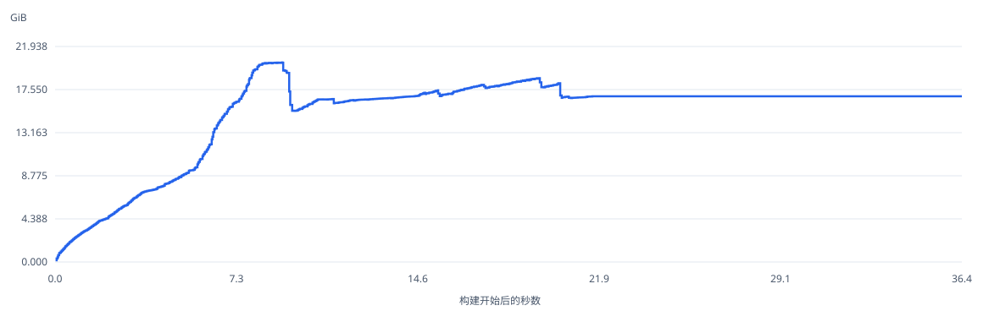

# Rspack 2.2.6 内存报告

full，每版本 3 轮。以下为中位数，范围为各轮最小值–最大值。

v24.20.0 · linux/arm64 · Rayon 6 / Tokio 6 · 50361 个生成模块 · 2026-11-11T04:05:39.261Z。

## combined

| 版本 | RSS 峰值 GiB（范围） | RSS 稳态 GiB | V8 稳态 GiB | 峰值 Δ | 稳态 Δ |
| --- | ---: | ---: | ---: | ---: | ---: |
| 2.2.6 | 20.313 (20.266–20.645) | 16.866 | 3.377 | — | — |

## server

| 版本 | RSS 峰值 GiB（范围） | RSS 稳态 GiB | V8 稳态 GiB | 峰值 Δ | 稳态 Δ |
| --- | ---: | ---: | ---: | ---: | ---: |
| 2.2.6 | 12.589 (12.573–12.646) | 9.081 | 1.351 | — | — |

## client

| 版本 | RSS 峰值 GiB（范围） | RSS 稳态 GiB | V8 稳态 GiB | 峰值 Δ | 稳态 Δ |
| --- | ---: | ---: | ---: | ---: | ---: |
| 2.2.6 | 8.418 (8.252–8.468) | 7.795 | 2.026 | — | — |

## 测量口径

- 使用每个版本自己的 npm release core 和 binding，不加载诊断 binding，也不采集 heap snapshot。各版本固定运行 3 轮，所有版本、轮次及 server/client 进程串行执行；轮次之间轮换版本顺序，依赖安装在测量前完成。
- 各版本共用一次生成的同一份输入、相同配置与插件、Node 和 worker 数。记录生成清单、输入脚本 SHA-256、实际 core/binding 版本，以及各版本的独立依赖锁文件；不会修改仓库原来的依赖。构建规模表中的 JS 字节数在插件追加注释前统计。
- 每轮先把 server/client 的发布构建 RSS 曲线按各自开始时刻对齐叠加，再取叠加峰值；较短构建结束后保持最后稳态读数。它包含两份进程运行时，是合计估算，不是原双 compiler 并行构建的实测峰值，也不是两个独立峰值的直接相加。
- 表格使用各轮指标的中位数，并列出最小值至最大值。稳态是 compiler close 前、空闲和四次显式 GC 后五次读数的中位数。RSS 每 20 ms 进程外采样，V8 每 50 ms 及 hook 边界采样，JS 同步阻塞会留下采样空隙。
- 曲线展示合计 RSS 峰值最接近中位数的一轮实测数据，并非逐时刻拼接的中位数曲线。V8 指标是 heapUsed；RSS 减去 V8 不能解释成 Rust 存活数据。数据结构和分配位置仍需单版本深度诊断报告。
- 这是单版本报告，不作跨版本增减比较；Δ 留空。请结合每轮波动范围判断读数。
