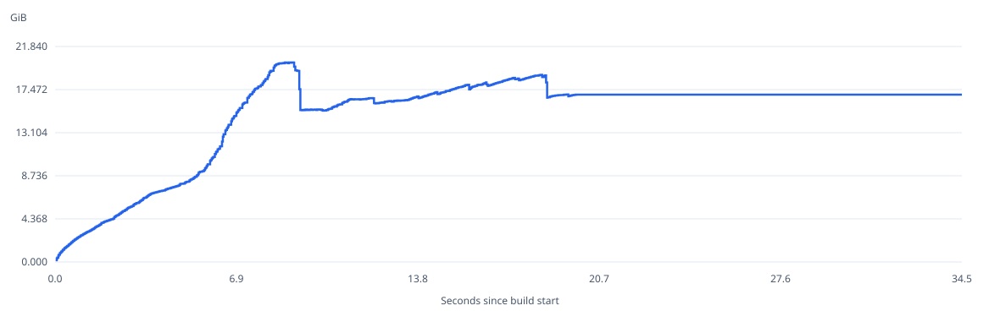

# Rspack 2.2.7 memory report

full, 3 rounds per version. Values are medians; ranges show the observed min–max across rounds.

v24.20.0 · linux/arm64 · Rayon 6 / Tokio 6 · 50361 generated modules · 2026-11-11T04:45:45.588Z.

## combined

| Version | Peak RSS GiB (range) | Steady RSS GiB | Steady V8 GiB | Peak Δ | Steady Δ |
| --- | ---: | ---: | ---: | ---: | ---: |
| 2.2.7 | 20.222 (20.135–20.962) | 16.958 | 3.377 | — | — |

## server

| Version | Peak RSS GiB (range) | Steady RSS GiB | Steady V8 GiB | Peak Δ | Steady Δ |
| --- | ---: | ---: | ---: | ---: | ---: |
| 2.2.7 | 12.590 (12.586–12.625) | 9.054 | 1.351 | — | — |

## client

| Version | Peak RSS GiB (range) | Steady RSS GiB | Steady V8 GiB | Peak Δ | Steady Δ |
| --- | ---: | ---: | ---: | ---: | ---: |
| 2.2.7 | 8.255 (8.210–8.355) | 7.894 | 2.026 | — | — |

## Methodology

- Each version uses its own published npm core and release binding, without a diagnostic binding or heap snapshots. Each version runs 3 rounds. All versions, rounds and server/client processes run sequentially; version order rotates each round, and dependency installation finishes before measurement.
- All versions share one generated input, configuration, plugins, Node version and worker counts. The report records the generator manifest, input SHA-256 hashes, actual core/binding versions and separate dependency lockfiles. Repository dependencies remain unchanged. JavaScript byte counts are read before the asset plugin appends comments.
- For each round, server/client release RSS curves are aligned at build start and added before taking the combined peak. The shorter run holds its final steady reading. This estimate includes two process runtimes; it is neither the measured concurrent dual-compiler peak nor the sum of independent peaks.
- Tables show the median and min–max range across rounds. Steady state is the median of five samples after idle time and four explicit GCs, before compiler.close(). RSS is sampled externally every 20 ms; V8 is sampled every 50 ms and at hook boundaries. Synchronous JS work leaves sampling gaps.
- Curves show the actual round whose combined RSS peak is nearest the median, not a pointwise median curve. V8 values are heapUsed. RSS minus V8 is not Rust live memory. Data structures and allocation sites require a separate diagnostic report.
- This report covers one version, so cross-version deltas are unavailable. Interpret readings together with their round-to-round ranges.
